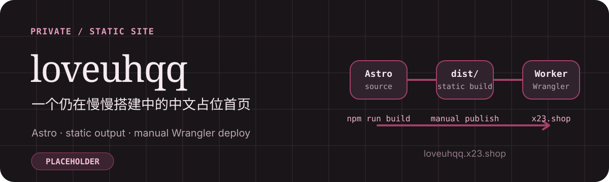

<p align="center">
  
</p>

# loveuhqq

一本写给何青青的纸上手账。

## 当前源码

- 正式网址：[loveuhqq.x23.shop](https://loveuhqq.x23.shop)
- 唯一正式源码：[liangjie78/loveuhqq-site](https://github.com/liangjie78/loveuhqq-site)（Private）
- 页面结构：封面、日子、照片、心里话、往后、信、页脚，自然连续滚动；另有相册页 `/photos/` 和 404 页（`dist/404.html` 由 `wrangler.jsonc` 的 `not_found_handling: "404-page"` 送出，缺这项时 Workers 只回空 404）。
- 视觉与交互：暖色纸面、蜡封红、思源宋体竖排标题；纸心与邮戳、按月排列的“一天一格”日历、胶带拍立得、横线信纸和可点的信封。支持拍立得灯箱（键盘与滑动）、日历点选与方向键翻看读数、进入第二年后的往年回看（“← 上一年 / 下一年 →”）、门禁日期格和减少动态效果偏好。详见 [设计说明](docs/DESIGN.md)。
- 纪念时间：从 2026-07-01 开始，当天算第 1 天，按北京时间自动更新；JavaScript 不可用时保留文案和起始日期。
- 下一纪念日：第 100 天之后转向下一周年，纪念日当天显示“今天”，跨日和返回页面时自动刷新。
- 内容状态：相册是登录后才能看到的真实照片（保存在 Workers KV，经 Worker 鉴权后送出）；值得标记的日子（`src/data/moments.ts`）已登记 3 个用户确认的日子。百日信须解锁共同手账且到达北京时间 2026-10-08 00:00 才能阅读；正式内容通过私密 KV 上传，不进入仓库，尚未上传时沿用已确认初稿。没有网站内的信件编辑后台；照片可在解锁后的相册页「贴一张」，也可用本机 prepare/upload 脚本批量维护。
- 技术边界：Astro + TypeScript + 普通 CSS，页面静态生成；Cloudflare Worker 提供登录和共享手账接口，D1 保存备注、清单和会话，不引入 UI 框架。
- 共同手账：访客浏览展示内容，解锁后两个人可以查看、编辑同一份备注和清单。云端按单条记录保存并检测编辑冲突，页面可见时每 10 秒同步；登录后可在不同设备继续使用。

界面截图：[桌面封面](docs/previews/journal-desktop.webp) · [桌面日历](docs/previews/journal-days-desktop.webp) · [手机封面](docs/previews/journal-mobile.webp) · [手机日历](docs/previews/journal-days-mobile.webp) · [门禁](docs/previews/journal-gate-mobile.webp)。截图用于展示源码界面，日期计数表示截图时的状态；实际页面按访问当天更新。顶部项目标识插画不作为当前页面截图。上述内容描述当前源码，不能据此判断正式网址已更新。

## 本地开发

使用满足 `package.json` 引擎要求的 Node.js 和 npm。依赖版本由 `package-lock.json` 固定：

```sh
npm ci
npm run dev
npm test
npm run build
npm run preview
```

新增可见文案后运行 `npm run subset:font` 重新生成宋体子集并连同字符清单一起提交，否则 `tests/font-subset.test.mjs` 会失败、页面会回退到系统字体。

`npm test` 保留日期边界、会话与私密访问、保存冲突、相册并发及上传工具的行为测试，并用一条真实 Worker/D1 链路检查运行时兼容性。日期等边界在轻量测试中验证；界面布局和交互通过真实浏览器验收，不用源码关键词或历史截图检查代替。

构建输出在 `dist/`，不提交到 Git。当前页面入口是 [`src/pages/index.astro`](src/pages/index.astro)，样式入口是 [`src/styles/global.css`](src/styles/global.css)。

相册照片不进仓库：用 `npm run photos:prepare -- <照片文件夹> --featured "标题,标题,标题"` 在本机生成去除 EXIF 的 WebP 和清单（输出到已忽略的 `.private-photos/`，文件名即标题），再用 `npm run photos:upload:preview` 或 `photos:upload:production` 上传到对应的 KV 命名空间，详见 [部署说明](docs/DEPLOYMENT.md#私密相册)。日期仍只修改 `src/lib/anniversary.ts` 中的来源，不在页面写死天数。

百日信正式正文放在已忽略的 `.private-letter/hundred-day.json`，运行 `npm run letter:check` 检查格式；得到当前任务生产上传授权后用 `npm run letter:upload:production` 写入私密 KV。真实信件不上传预览环境，也不写入源码、测试或 PR；详见 [私密百日信](docs/DEPLOYMENT.md#私密百日信)。

## 部署路径

当前采用手动项目级 Wrangler 部署：经用户授权后，从已合并的 `main` 干净源码运行 `npm ci` 和 `npm run deploy`。`npm run deploy` 会先构建，再把 `dist/` 上传到独立 Worker `loveuhqq-site`，并绑定正式 Custom Domain：

```text
GitHub main → npm run build → dist/ → Cloudflare Worker → loveuhqq.x23.shop
```

GitHub 自动部署尚未配置；没有绕过权限或创建额外凭据。GitHub 是唯一正式源码，生产构建来自本仓库相同提交，不使用其他仓库或 Sites 托管副本。

## 临时预览

可见 UI 改动完成后，运行 `npm run deploy:preview`，从当前分支构建并更新独立 Worker `loveuhqq-site-preview`。验收地址是 [临时预览站](https://loveuhqq-site-preview.1756127916.workers.dev/)；每次更新后需实际检查首页、受影响页面和资源，并把链接与截图发给用户。此地址公开可访问，始终显示最近一次手动上传的预览版本，不会自动跟随 Git 提交，也不影响正式域名。

预览配置位于 `wrangler.preview.jsonc`，只有 `workers.dev` 地址，没有正式站点的 Custom Domain 路由。共享手账使用独立的 `loveuhqq-notebook-preview` 数据库，不能导入真实私人记录用于公开验收。通过 `npm run password:preview` 在交互式终端设置预览编辑密码，输入不会显示，也不需要写进聊天或源码。

生产操作、回滚、DNS 边界和已有验证证据见 [部署说明](docs/DEPLOYMENT.md)，视觉约束见 [设计说明](docs/DESIGN.md)。生产部署、Cloudflare 和 DNS 修改都需要当前任务的明确授权。

## 相关文件

| 文件 | 作用 |
| --- | --- |
| [`astro.config.mjs`](astro.config.mjs) | Astro 构建配置 |
| [`wrangler.jsonc`](wrangler.jsonc) | Worker、静态资源目录和 Custom Domain 配置 |
| [`wrangler.preview.jsonc`](wrangler.preview.jsonc) | 独立预览 Worker 配置，不绑定正式域名 |
| [`public/favicon.svg`](public/favicon.svg) | 页面 favicon |
| [`docs/DEPLOYMENT.md`](docs/DEPLOYMENT.md) | 发布、核验和回滚边界 |
| [`src/lib/anniversary.ts`](src/lib/anniversary.ts) | 起始日期、北京时间天数与跨日计算 |
| [`scripts/subset-font.mjs`](scripts/subset-font.mjs) | 按站点用字生成思源宋体子集（`npm run subset:font`） |
| [`docs/DESIGN.md`](docs/DESIGN.md) | 纸上手账的视觉、布局与交互约定 |

## 生产状态说明

当前采用手动发布，合并 PR 不会自动更新正式网站。本次手账改版的源码和截图不构成生产已更新的证明，正式网站版本须以对应部署记录及域名、正文、资源核验为准。既往 V2 工作记录见 [PR #6](https://github.com/liangjie78/loveuhqq-site/pull/6)，已有部署证据保留在 [部署说明](docs/DEPLOYMENT.md) 中。
